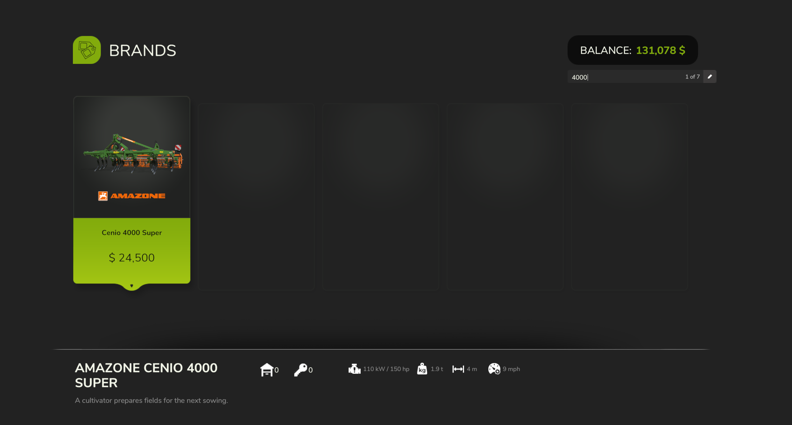
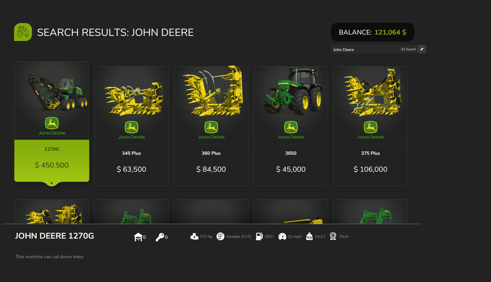
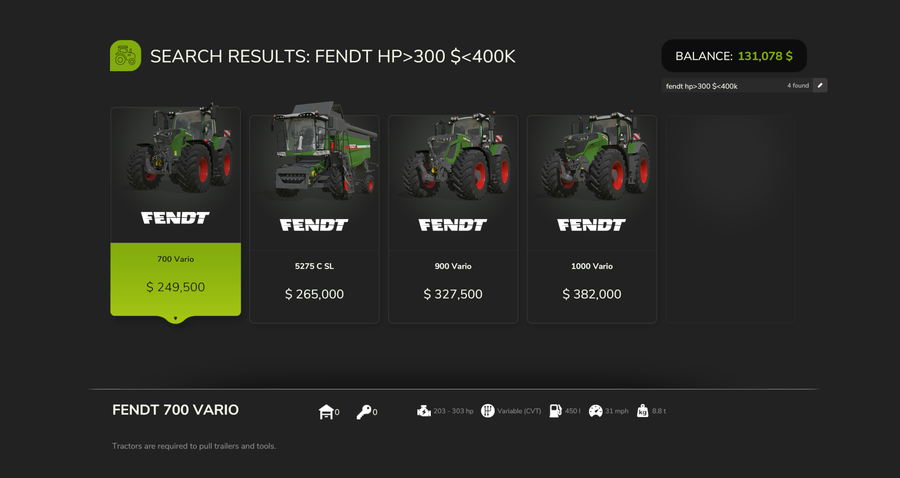
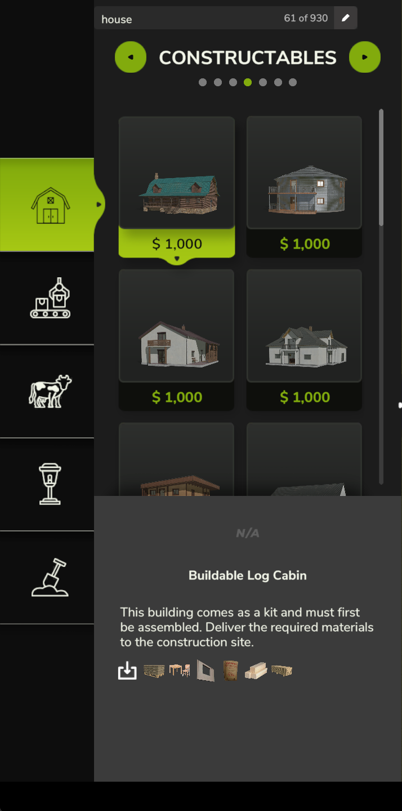
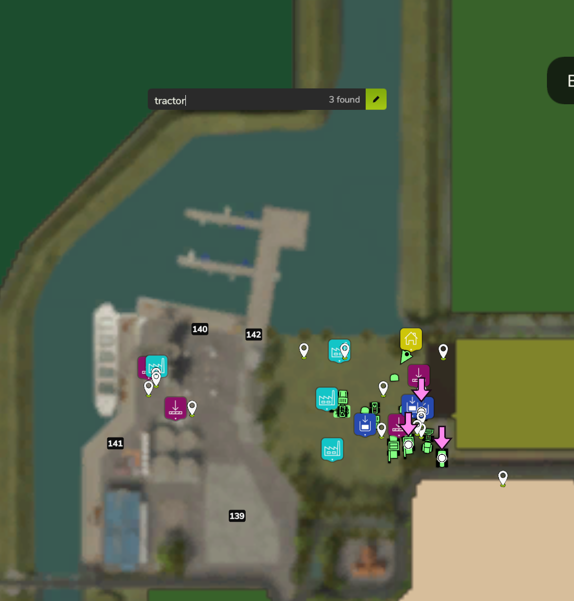

<p align="center">
  
</p>

<h1 align="center">Searchables</h1>

<p align="center">
  <b>Search as you type, right on the screen, in Farming Simulator 25.</b><br>
  Shop · Construction · Map (with Where's My Stuff built in)
</p>

---

FS25 has hundreds of vehicles, tools and buildings, and finding the one you want means scrolling through category after category. Searchables puts a search box right on the shop, construction and map screens. Click it, start typing, and the list narrows down as you type. There's no hotkey to remember and no pop-up.



## Features

### 🛒 Shop
- **Filter any list as you type.** Open a category or a brand and type to narrow it down.
- **Search the whole shop.** On the category, brand, pack or DLC tiles, type two or more letters and every match in the shop appears in one list. Items with your words in their name come first.
- **Searches more than names:** brand, category, DLC, mod name and mod author.
- **Every word counts:** `fendt 700`, `john deere tedder` and `macdon pack` all work.
- **Leave things out:** start a word with `-`. `-mod` hides mod items, `-trailer` hides trailers. `mod` shows only mod items.
- **Used and owned items:** `used` finds second-hand items in the sales list, and price filters use their sale price.
- **Filter by price, horsepower, working width, capacity, weight, speed and power needed**, mixed in with words. See [Spec filters](#-spec-filters) below.
- A match count shows in the box, for example `7 of 42`.



### 🐎 Spec filters
Type these in the shop search box, alone or together with words. Every filter works with `>`, `<`, `>=`, `<=`, a range (`6-9`) or an exact number.

| Filter | Examples | Finds |
|---|---|---|
| Price | `$<50k`, `price>100000`, `$100k-200k`, `$144,500` | Shop price |
| Affordable | `affordable` | Everything your farm can pay for right now |
| Horsepower | `hp>200`, `200-300hp`, `250hp`, `300ps` | Engine power |
| Working width | `width>9`, `6-9m`, `12m` | Headers, cultivators, sprayers, mowers... |
| Capacity | `l>30000`, `30000l`, `cap 20000-40000` | Trailers, tanks, seeders, sprayers |
| Weight | `t<10`, `10t`, `weight 5-8` | Weight in tons |
| Speed | `kph>50`, `mph>30`, `50 km/h` | Top speed (working speed for tools) |
| Power needed | `needhp<150` | Tools your tractor can pull (PTO power) |
| Mixed | `fendt hp>300 $<400k`, `trailer l>30000 affordable` | All of them at once |

- Spaces are fine: `hp > 200`, `200 hp`, `$ 100k - 200k`, `12 m`.
- `k` means thousand and `m` after a price means million (`$1.5m`). `€` and `£` work the same as `$`.
- An item with several options (engines, tanks, widths) matches if **any** of them fits, so a 200–300 hp tractor shows up for `hp>280`.
- The price is the shop's base price, before options.
- In store-wide results, the first filter you typed decides the order: `hp>200` lists by horsepower, `$<50k` by price, lowest first.
- On the construction screen, price filters and `affordable` work too.



### 🏗️ Construction
- Type to filter the buildings in **every category and tab** at once: `house`, `silo`, `greenhouse`, `fence`, `cow`.
- Add a price: `silo $<100k`, or `affordable`.



### 🎮 Controls
- **Settings → Controls** has a search box next to the CONTROLS title, at the top right. Type an action, a section or a key: `cruise control`, `lights`, `vehicle`, `ctrl`, `f5`.
- Changing a key works as usual while the list is filtered.

### 🗺️ Map: Where's My Stuff
- Type in the box at the top of the map, or press **Ctrl+F**, to find **vehicles, bales, pallets, big bags, buildings, fields and properties**.
- **Find vehicles by license plate.** `AB-123`, `ab 123` and `ab123` all find the same truck.
- Every match gets a **big arrow that shrinks down onto it**, so you can spot it at a glance. The nearest 40 get arrows; the rest get a marker dot (up to 500).
- Press **Enter** to centre the map on the nearest match.
- **Find fields and properties by number:** type `178` to find field or property 178. A number only matches whole numbers, so `178` won't find 1780.
- **Find an NPC farmer's land:** type their name, e.g. `huber`, to mark every field and property they still own.
- One arrow per piece of land: when field 5 and property 5 both match, only the field gets an arrow.
- **Crops and field work:** fields show their crop and what they need. Search `wheat`, `ready`, `growing`, `withered`, `harvested`, `lime`, `fertilize`, `plow`, `roll`, `weeds` or `stones`, e.g. `wheat ready` or `barley fertilize`.
- **Where to sell:** `sell wheat` marks every selling point that buys wheat, with its price per 1000 l. The best price is marked.
- **Land for sale:** `for sale` marks every property you can buy, with price and size. Add filters: `for sale $<100k ha>5`.
- **Contracts:** `contract` marks fields with a contract you can take or are working on, with type and reward. Narrow it down: `contract harvest`, `contract huber`, `contract $>10k`.
- **Filters on the map:** the shop filters work here too. `wool l>1000` finds only big wool pallets; `fendt hp>200` finds your own big Fendts.
- **Your vehicles:** vehicles show fuel, damage and dirt when they need attention. Search `fuel`, `damaged`, `dirty`, `helper`, `parked` or `leased`, or filter: `fuel<20`, `damage>50`, `dirt>50`.
- **Animals:** pens show how many animals they have and which food, water, straw or cleanliness bars are low: `cows low`.
- **Production:** production points show what they make, which inputs are missing and which outputs are full: `flour`, `missing`, `full`.
- **Stored goods:** `stored wheat` marks every storage holding wheat, with how much. `stored wheat l>10000` for the big ones.
- **Results list:** the nearest 8 matches are listed under the search box with their distance. Click one to move the map there; double-click to make it your navigation target.
- Search by fill type too: `wool`, `round bale`, `wheat`, `field 12`, `property 40`, `owned`.



## How to use it

| What you do | What happens |
|---|---|
| Click the search box | Start typing (menu hotkeys pause while you type) |
| Type | The list or map updates as you type |
| **Ctrl+F** while walking or driving | Open the map with the cursor in the search box |
| Click in an empty box | Your last five searches are listed: click one to run it again |
| **Enter** or click elsewhere | Stop typing and keep the search |
| **Esc** | Clear the search |
| **Ctrl+F**, or **right stick click** on a controller | Jump into the search box on the shop, construction or map screen (opens the on-screen keyboard on Steam Deck / Big Picture) |
| Go back, switch tabs or close the screen (shop/construction) | The search clears |

## Cheat sheet

Every special word and filter in one place. Mix them with normal words, e.g. `fendt hp>300 $<400k` or `sell wheat`.

**Works everywhere (shop, construction, map)**

| Type | Does |
|---|---|
| `-word` | Leaves out matches containing the word: `-mod`, `-trailer` |
| `$<50k`, `price>100000`, `$100k-200k`, `$144,500` | Price |
| `affordable` | Only what your farm can pay for right now |

**Shop**

| Type | Does |
|---|---|
| `mod` | Only mod items (`-mod` hides them) |
| `used` | Second-hand items in the sales list |
| `hp>200`, `200-300hp`, `300ps` | Horsepower |
| `needhp<150` | Power a tool needs |
| `width>9`, `6-9m` | Working width |
| `l>30000`, `cap 20000-40000` | Capacity |
| `t<10`, `weight 5-8` | Weight |
| `kph>50`, `mph>30` | Speed |

**Map: what to find**

| Type | Marks |
|---|---|
| a name, brand or plate: `fendt`, `ab123` | Your vehicles |
| `wool`, `round bale`, `pallet`, `big bag` | Bales, pallets and big bags |
| a building name: `silo`, `cow barn` | Your buildings |
| a number: `178` | Field or property 178 |
| `owned` | Your own fields and properties |
| a farmer's name: `huber` | The land an NPC farmer still owns |

**Map: special words**

| Type | Marks |
|---|---|
| `sell wheat` | Selling points that buy wheat, with price; best price marked |
| `stored wheat` | Your storages holding wheat, with how much |
| `for sale` | Land you can buy, with price and size (`for sale $<100k ha>5`) |
| `contract` | Fields with a contract (`contract harvest`, `contract huber`, `contract $>10k`) |
| `wheat`, `ready`, `growing`, `withered`, `harvested` | Fields by crop and growth |
| `lime`, `fertilize`, `plow`, `roll`, `weeds`, `stones` | Fields that need that work |
| `fuel`, `damaged`, `dirty` | Vehicles needing attention (`fuel<20`, `damage>50`, `dirt>50`) |
| `helper`, `parked`, `leased` | Vehicles by what they're doing |
| `low` | Animal pens running low on food, water, straw or cleanliness (`cows low`) |
| `missing`, `full` | Production points missing inputs or with full outputs |
| `l>1000` | Pallets, bales and storages holding more than 1000 l (`wool l>1000`) |
| `ha>5` | Fields and properties bigger than 5 ha |

**Settings → Controls**

| Type | Shows |
|---|---|
| an action: `cruise`, `lights` | Controls with that name |
| a section: `vehicle`, `player` | Every control in that section |
| a key: `ctrl`, `f5`, `space` | Controls bound to that key |

Special words also work in your game's language, e.g. `verkaufen weizen` or `vendre blé`.

## In-game help

Everything above is also in the game: pause menu → **Help** → **Searchables**.

## Installation

1. Download `FS25_Searchables.zip`. Don't unzip it.
2. Put it in your mods folder:
   `Documents\My Games\FarmingSimulator2025\mods`
3. Start the game and tick **Searchables** in your savegame's mod list.

> **Upgrading from Where's My Stuff?** It's built into Searchables now. Remove `FS25_WheresMyStuff.zip` from your mods folder so the two don't run side by side. If the game warns that Where's My Stuff is missing when you load your savegame, that's safe to accept: it never saved anything to your savegame.

## Multiplayer

Supported. Everything runs on each player's own screen, so nobody else sees your searches or markers. Buying and placing still go through the game's normal purchase. Like any mod, everyone on the server needs it, and the game offers it for download when players join. On a dedicated server it loads without problems and simply does nothing there.

## Console commands

You don't need these to use the mod; they're extras for checking things and troubleshooting. They only work with the game's developer console switched on:

1. **Close the game.** It rewrites its settings when it exits and would undo the change.
2. Open `Documents\My Games\FarmingSimulator2025\game.xml` in a text editor.
3. Find `<controls>false</controls>` (inside `<development>`) and change it to `<controls>true</controls>`. Save.
4. Start the game and load your savegame. Press **~** (the key left of 1) **twice**: the first press opens chat, the second opens the console.
5. Type a command and press Enter. Capitals matter: `wmsField 33`, not `wmsfield 33`.

| Command | What it does |
|---|---|
| `wmsFind <text>` | The map search, listed nearest first |
| `wmsTarget <number>` | Set one of those results as your map target |
| `wmsField <number>` | Show what the field search reads for a field (crop, growth, lime, fertilizer...) |
| `wmsSummary` | Totals of your pallets, big bags and bales per fill type |
| `wmsList <fillType>` | Every item of one fill type, and where it is |
| `wmsLeftovers` | Bales and pallets lying out on fields |
| `wmsShow <fillType\|ALL\|LEFTOVERS\|EMPTY>` | Mark items on the map |
| `wmsGoto <fillType\|ALL\|LEFTOVERS\|EMPTY>` | Mark items and target the nearest |
| `wmsHide` | Remove the map markers |
| `searchablesMove shop\|construction\|controls <dx> <dy>` | Nudge a search box by a few pixels |
| `searchablesDumpList [seconds]` | Print how the lists on the open screen are built; with seconds, waits first so you can open the screen (for troubleshooting) |
| `searchablesDumpUi` | Print the open screen's layout (for troubleshooting) |
| `searchablesDumpItem` | Print the first entry of the open shop list (for troubleshooting) |

## FAQ

**Typing a letter opened another menu!**
Click into the box first. Menu hotkeys only pause while the box has a blinking cursor.

**I don't see a search box in the shop.**
It shows on the shop's item lists and on the category, brand, pack and DLC tiles. Shop pages that don't list items have no box.

**Does it work with mod vehicles and mod buildings?**
Yes. Anything in the shop or construction menu can be searched, and you can search by the mod's name or author too.

**Can I search by horsepower, price or width?**
Yes, in the shop: `hp>200`, `$100k-200k`, `width>9`, `l>30000` and more. Price filters also work on the construction screen. See [Spec filters](#-spec-filters).

**My horsepower (or width, capacity...) search missed something.**
These values come from each vehicle's own file. Searchables reads those in the background during your first minute or so in the game. A search made before then still works, but may pause briefly the first time. Mod vehicles that don't list a value can't be found by it.

## For modders

- **Shop:** `ShopItemsFrame.setDisplayItems` is wrapped, so every list the game shows passes through the filter, including refreshes. Store-wide results are shown in the shop's own item list. Buying works exactly as it does from a category.
- **Construction:** after `ConstructionScreen:rebuildData` the full `items[category][tab]` lists are set aside, and the screen gets filtered copies.
- **Map:** `IngameMapElement.update` and `draw` are wrapped to show the box and the arrows.
- **Why everything hooks `update`:** a screen's `onOpen`, `onClose` and `onPageChange` callbacks are bound when the game loads its UI, before any mod, so hooking them does nothing. `update` is called on the screen directly.
- **Menu buttons while typing:** while a box has the cursor, menu button registration is held back and replayed when typing ends. Otherwise the buttons would land in the text input's input context and stop working.

Source layout:

```
scripts/Searchables.lua              shared matching, console commands, lifecycle
scripts/SearchablesSearchBox.lua     the search box element
scripts/SearchablesShop.lua          shop hooks
scripts/SearchablesConstruction.lua  construction hooks
scripts/WheresMyStuff*.lua           map search, scanning, markers
gui/                                 box layout and profiles
```

## Credits

Made by **Fennell**. Where's My Stuff by Fennell, now part of Searchables.
